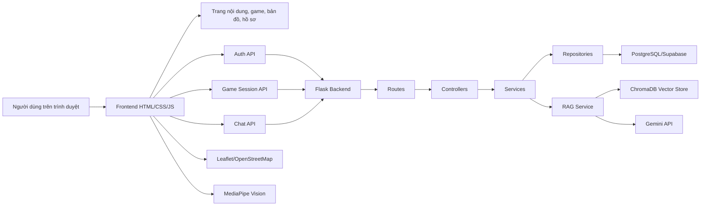
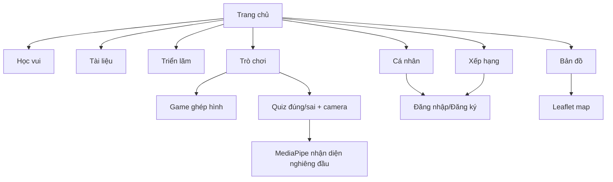
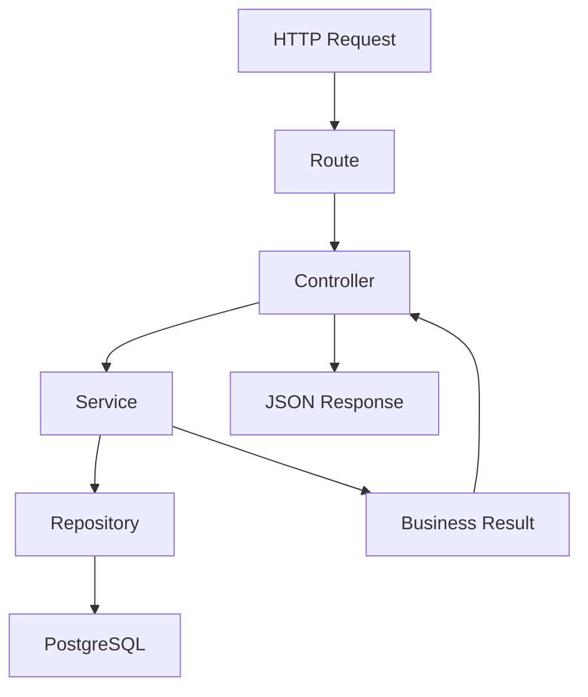
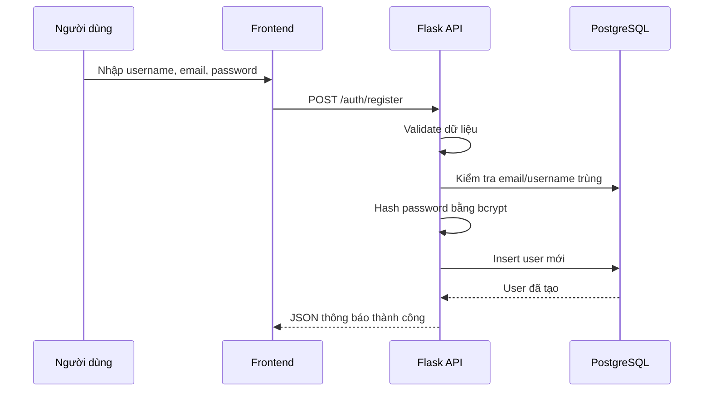
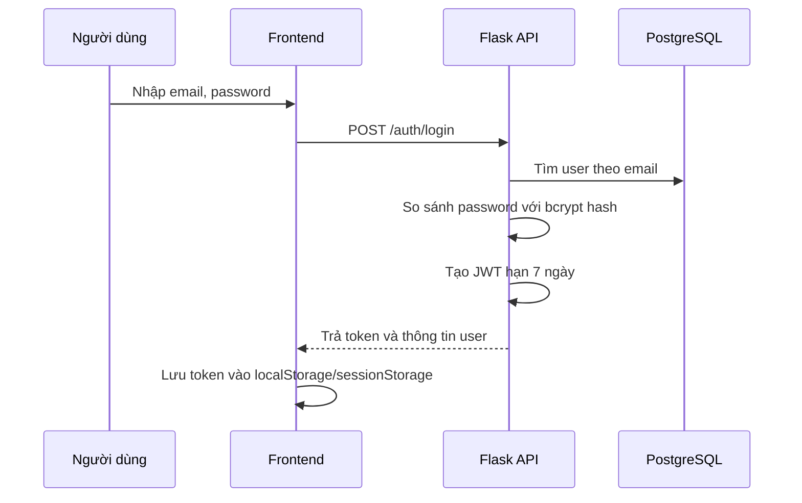
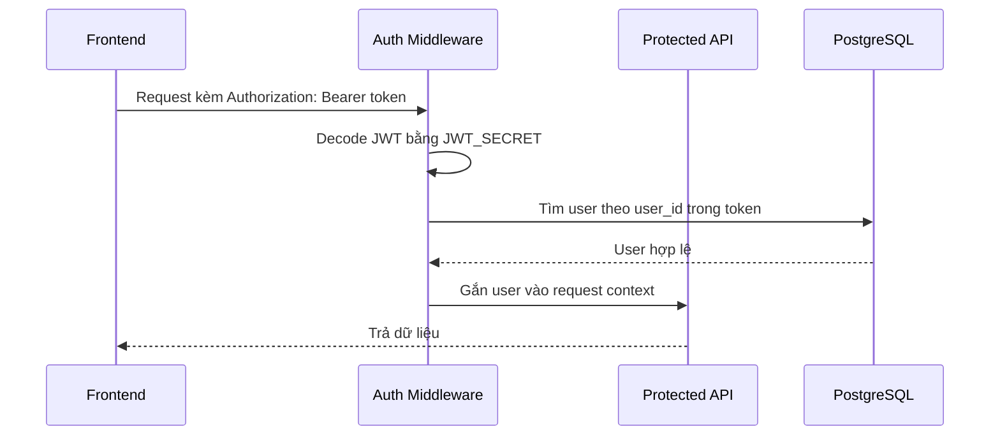
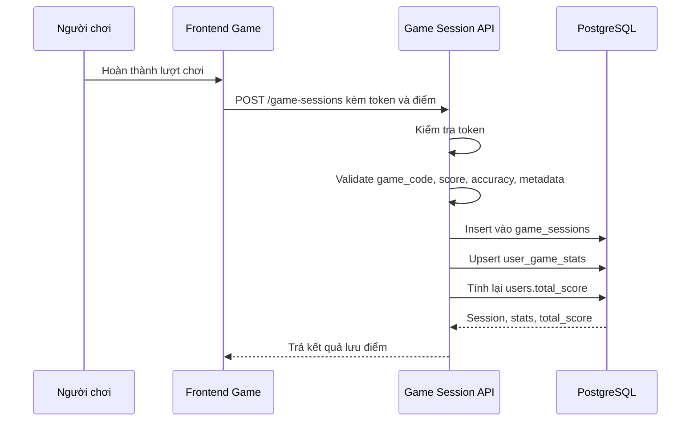
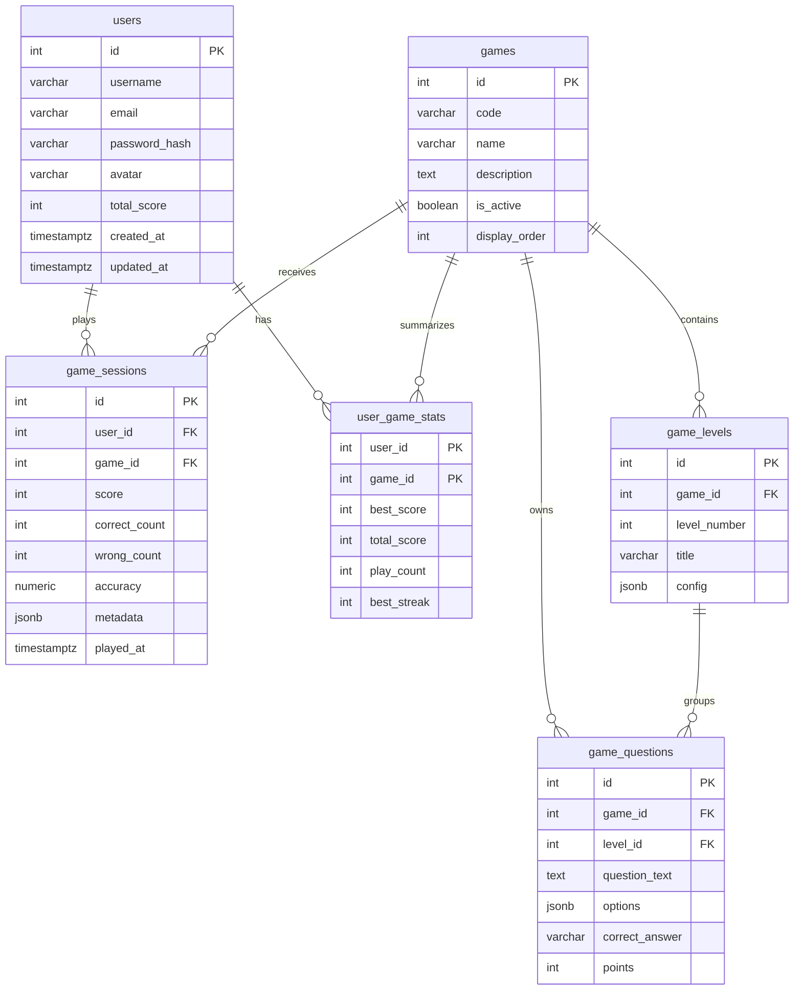
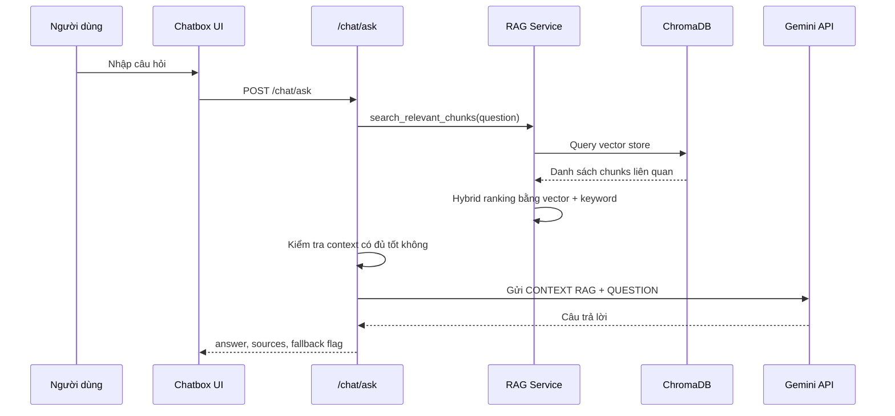

# BÁO CÁO DỰ ÁN: ĐÔNG SƠN DIGITAL MUSEUM

## 1. Giới thiệu sản phẩm/giải pháp

**Đông Sơn Digital Museum** là một website bảo tàng số giúp người dùng khám phá trống đồng Đông Sơn và văn hóa Việt cổ thông qua nội dung học tập, hình ảnh trực quan, bản đồ di sản, trò chơi tương tác và trợ lý AI hỏi đáp theo kho tri thức.

Thay vì chỉ trình bày kiến thức lịch sử theo dạng văn bản dài, sản phẩm tổ chức trải nghiệm theo hướng “đọc để hiểu, nhìn để nhớ, chơi để thuộc”. Người dùng có thể bắt đầu từ trang chủ, đọc phần học vui, xem tài liệu chuyên sâu, khám phá các hiện vật tiêu biểu, tương tác với bản đồ địa điểm Đông Sơn, chơi game để kiểm tra kiến thức và hỏi AI Đông Sơn khi cần giải thích nhanh.

Mục tiêu của giải pháp là số hóa việc học di sản, giúp kiến thức về trống đồng Đông Sơn trở nên gần gũi hơn với học sinh, sinh viên và người yêu lịch sử Việt Nam.

## 2. Mô tả sản phẩm/giải pháp dự thi

### 2.1. Phân tích lý do lựa chọn

Di sản văn hóa Đông Sơn, đặc biệt là trống đồng, là một phần quan trọng trong lịch sử Việt Nam. Tuy nhiên, cách tiếp cận truyền thống thường gặp một số hạn chế:

- Nội dung lịch sử dễ bị xem là khô khan nếu chỉ trình bày bằng sách giáo khoa hoặc văn bản tĩnh.
- Người học trẻ thường cần hình ảnh, tương tác và thử thách ngắn để ghi nhớ tốt hơn.
- Nhiều thông tin về trống đồng như hoa văn, phân loại, cấu tạo, hiện vật tiêu biểu chưa được tổ chức thành một trải nghiệm học tập liền mạch.
- Các bảo tàng hoặc tài liệu chuyên sâu đôi khi chưa đủ thuận tiện cho người dùng phổ thông tra cứu nhanh.

Vì vậy, nhóm lựa chọn xây dựng một bảo tàng số về Đông Sơn để kết hợp ba hướng tiếp cận: giáo dục lịch sử, trải nghiệm trực quan và trò chơi hóa. Đây là đề tài có giá trị văn hóa rõ ràng, đồng thời có đủ không gian để áp dụng kỹ thuật web, backend, cơ sở dữ liệu, bản đồ số và trí tuệ nhân tạo.

### 2.2. Các tính năng sẽ có của sản phẩm/giải pháp

Website hiện có các nhóm chức năng chính sau:

**Trang chủ**

- Giới thiệu tổng quan về bảo tàng số Đông Sơn.
- Trình bày hành trình học tập: học vui, tài liệu, trò chơi.
- Hiển thị các hiện vật tiêu biểu như Ngọc Lũ, Hoàng Hạ, Cổ Loa, Tân Long.
- Sử dụng video nền, hình ảnh trống đồng và hiệu ứng cuộn để tạo cảm giác sinh động.

**Học vui**

- Cung cấp kiến thức nhập môn bằng ngôn ngữ dễ hiểu.
- Giúp người mới làm quen với khái niệm trống đồng, hoa văn, biểu tượng và giá trị văn hóa.
- Phù hợp với học sinh hoặc người dùng lần đầu tiếp cận chủ đề Đông Sơn.

**Tài liệu**

- Trình bày nội dung chuyên sâu hơn về trống đồng, văn hóa Đông Sơn, cấu tạo, hoa văn, kỹ thuật đúc đồng và phân loại.
- Đóng vai trò như kho tư liệu để người dùng tra cứu, đọc sâu và hệ thống lại kiến thức.

**Triển lãm**

- Giới thiệu các hiện vật và hình ảnh liên quan đến trống đồng.
- Hỗ trợ người dùng quan sát trực quan thay vì chỉ đọc mô tả.

**Bản đồ Đông Sơn**

- Tích hợp Leaflet và OpenStreetMap để hiển thị các địa điểm liên quan đến di sản Đông Sơn trên bản đồ Việt Nam.
- Có marker, chú giải, danh sách địa điểm nổi bật và bảng thông tin chi tiết.
- Giúp người học hiểu di sản Đông Sơn không chỉ là một hiện vật riêng lẻ mà gắn với không gian văn hóa, khảo cổ và bảo tàng.

**Trò chơi học tập**

- Game ghép hình trống đồng: người chơi kéo thả mảnh ghép để hoàn thiện hình trống đồng, có level, điểm, combo, thời gian và bảng điểm local.
- Game quiz đúng/sai: người chơi trả lời 25 câu hỏi theo 5 chương kiến thức; hỗ trợ chọn đáp án bằng phím, nút bấm và nhận diện nghiêng đầu qua camera bằng MediaPipe.
- Khu trò chơi giúp củng cố kiến thức bằng thử thách ngắn, có điểm số và cảm giác tiến bộ.

**Tài khoản người dùng**

- Đăng ký, đăng nhập, đăng xuất.
- Xác thực bằng JWT.
- Lưu thông tin người dùng gồm username, email, avatar, tổng điểm.
- Trang cá nhân cho phép xem và cập nhật hồ sơ.

**Bảng xếp hạng**

- Hiển thị bảng điểm, nhóm người chơi nổi bật và điểm cá nhân.
- Backend đã có thiết kế lưu phiên chơi, thống kê điểm theo game và view leaderboard.
- Frontend hiện có giao diện bảng xếp hạng và đồng bộ điểm tổng của người dùng đang đăng nhập.

**Chatbox AI Đông Sơn**

- Chatbox xuất hiện trên các trang chính.
- Người dùng đặt câu hỏi về trống đồng và văn hóa Đông Sơn.
- Backend dùng RAG: tìm thông tin liên quan trong kho tri thức ChromaDB, sau đó gửi context cho Gemini để sinh câu trả lời.
- Có cơ chế fallback nếu dữ liệu không đủ hoặc LLM lỗi, hạn chế việc AI tự bịa thông tin.

### 2.3. Sẽ ứng dụng vào những nền tảng nào và ứng dụng như thế nào

Sản phẩm được xây dựng dưới dạng website nên có thể sử dụng trên các nền tảng phổ biến:

- **Máy tính/laptop:** phù hợp cho thuyết trình, học tập tại lớp, demo sản phẩm và khám phá đầy đủ giao diện.
- **Điện thoại/tablet:** phù hợp cho học sinh tự học, xem nhanh tài liệu, dùng bản đồ và thử các trò chơi đơn giản.
- **Môi trường trường học:** giáo viên có thể dùng website như học liệu số trong tiết học lịch sử hoặc hoạt động ngoại khóa.
- **Bảo tàng/sự kiện văn hóa:** có thể triển khai tại kiosk hoặc màn hình tương tác để khách tham quan tự khám phá.
- **Nền tảng web mở rộng trong tương lai:** có thể triển khai lên cloud, kết nối Supabase PostgreSQL, mở rộng API và tích hợp thêm nhiều bộ sưu tập hiện vật.

Về cách ứng dụng, người dùng chỉ cần truy cập website qua trình duyệt. Các chức năng đọc tài liệu và khám phá giao diện có thể hoạt động như frontend tĩnh. Các chức năng đăng nhập, hồ sơ, lưu điểm game và AI chatbox cần backend Flask và database hoạt động.

### 2.4. Dự kiến sản phẩm/giải pháp sẽ mang lại hiệu quả/lợi ích như thế nào

Sản phẩm mang lại các lợi ích chính:

- **Đối với người học:** giúp kiến thức lịch sử trở nên dễ tiếp cận hơn thông qua hình ảnh, trò chơi và hỏi đáp AI.
- **Đối với giáo viên:** có thêm công cụ trực quan để minh họa bài học về văn hóa Đông Sơn.
- **Đối với hoạt động bảo tồn di sản:** góp phần lan tỏa kiến thức về trống đồng và văn hóa Việt cổ bằng công nghệ số.
- **Đối với nhóm phát triển:** thể hiện khả năng kết hợp frontend, backend, database, bản đồ số, gamification và AI/RAG trong một sản phẩm thống nhất.
- **Đối với cuộc thi:** sản phẩm có chủ đề văn hóa rõ ràng, có tính ứng dụng thực tế và có chiều sâu kỹ thuật để phát triển tiếp.

Hiệu quả kỳ vọng là người dùng không chỉ đọc thông tin mà còn tương tác, ghi nhớ và quay lại sử dụng thông qua game, điểm số, bảng xếp hạng và trợ lý AI.

## 3. Mô tả công nghệ được ứng dụng để phát triển sản phẩm

### 3.1. Frontend

Frontend được xây dựng bằng:

- **HTML5:** tổ chức cấu trúc các trang.
- **CSS3:** xây dựng giao diện, responsive layout, hiệu ứng, màu sắc và nhận diện thị giác theo chủ đề Đông Sơn.
- **JavaScript thuần:** xử lý tương tác, điều hướng, hiệu ứng, game, localStorage/sessionStorage và gọi API backend.
- **Leaflet + OpenStreetMap:** xây dựng bản đồ di sản Đông Sơn.
- **MediaPipe Tasks Vision:** nhận diện khuôn mặt trong game quiz, cho phép người chơi nghiêng đầu để chọn đáp án.

Các trang chính gồm:

- `index.html`: trang chủ.
- `hocvui.html`: học vui.
- `trienlam.html`: triển lãm.
- `tailieu.html`: tài liệu.
- `trochoi.html`: khu trò chơi.
- `bxh.html`: bảng xếp hạng.
- `profile.html`: hồ sơ cá nhân.
- `login.html`, `register.html`: xác thực.
- `Map.html`: bản đồ.
- `game/puzzle.html`, `game/codechayquiz.html`: game.

### 3.2. Backend

Backend được xây dựng bằng:

- **Python Flask:** cung cấp REST API.
- **Flask-CORS:** cho phép frontend gọi API từ local server khác port.
- **psycopg2:** kết nối PostgreSQL/Supabase PostgreSQL.
- **bcrypt:** mã hóa mật khẩu.
- **PyJWT:** tạo và xác thực JSON Web Token.
- **python-dotenv:** đọc biến môi trường từ file `.env`.

Backend tổ chức theo mô hình phân lớp:

- `routes`: khai báo endpoint.
- `controllers`: nhận request, trả response.
- `services`: xử lý nghiệp vụ.
- `repositories`: truy vấn database.
- `middlewares`: xác thực JWT.
- `config`: cấu hình kết nối database.
- `database/schema.sql`: định nghĩa bảng, index, view và seed dữ liệu.

### 3.3. Database

Hệ thống sử dụng PostgreSQL hoặc Supabase PostgreSQL. Các bảng chính:

- `users`: thông tin tài khoản người dùng.
- `games`: danh sách game.
- `game_levels`: level/cấu hình từng game.
- `game_questions`: câu hỏi quiz.
- `game_sessions`: từng lượt chơi của người dùng.
- `user_game_stats`: thống kê tổng hợp theo người dùng và game.
- `leaderboard_view`: view phục vụ bảng xếp hạng.

### 3.4. AI/RAG Chatbox

Chatbox AI sử dụng:

- **ChromaDB:** lưu vector store cho kho tri thức Đông Sơn.
- **Local hash embedding:** tạo vector cục bộ cho tài liệu và câu hỏi.
- **Hybrid ranking:** kết hợp điểm vector distance và keyword overlap.
- **Gemini API:** sinh câu trả lời dựa trên context tìm được.
- **Prompt ràng buộc:** AI chỉ được trả lời dựa trên CONTEXT RAG, nếu không đủ dữ liệu phải nói rõ.

## 4. Thiết kế hệ thống Website

Đây là phần quan trọng nhất của sản phẩm vì website không chỉ là giao diện tĩnh mà có nhiều thành phần phối hợp: frontend, backend API, database, xác thực, game, leaderboard, bản đồ và AI RAG.

### 4.1. Mục tiêu thiết kế hệ thống

Hệ thống được thiết kế theo các mục tiêu:

- **Dễ sử dụng:** người dùng truy cập bằng trình duyệt, không cần cài app.
- **Tách biệt frontend và backend:** frontend tập trung trải nghiệm, backend xử lý dữ liệu và nghiệp vụ.
- **Dễ mở rộng:** có thể thêm game mới, tài liệu mới, hiện vật mới hoặc API mới mà không phá cấu trúc cũ.
- **Bảo mật cơ bản:** mật khẩu được hash, API cần đăng nhập dùng JWT.
- **Dữ liệu có tổ chức:** điểm game, phiên chơi và tài khoản được lưu trong PostgreSQL.
- **AI có kiểm soát:** chatbot không trả lời tự do mà dựa trên kho tri thức RAG.

### 4.2. Kiến trúc tổng thể



Kiến trúc này có thể hiểu theo 4 lớp:

**Lớp trình bày**

- Chạy trên trình duyệt.
- Gồm các trang HTML, CSS, JavaScript.
- Xử lý tương tác UI, hiệu ứng, game, map và chatbox.

**Lớp API**

- Flask tiếp nhận request từ frontend.
- Các endpoint được gom theo nhóm: `auth`, `chat`, `game-sessions`.
- Dữ liệu trả về theo JSON.

**Lớp nghiệp vụ**

- Service kiểm tra logic đăng ký/đăng nhập, đổi mật khẩu, cập nhật hồ sơ.
- Service game kiểm tra payload, tính accuracy, lưu phiên chơi và cập nhật thống kê.
- Service chat tìm context trong vector store và gọi LLM.

**Lớp dữ liệu**

- PostgreSQL lưu dữ liệu tài khoản, game, điểm, thống kê.
- ChromaDB lưu vector tri thức phục vụ chatbot.

### 4.3. Thiết kế frontend

Frontend là website tĩnh, nhưng có nhiều module tương tác:



Thiết kế frontend có các điểm chính:

- Mỗi trang có vai trò riêng, giúp người dùng không bị quá tải thông tin.
- Giao diện sử dụng hình ảnh trống đồng, hoa văn, màu sắc cổ vật để giữ bản sắc Đông Sơn.
- JavaScript được chia theo từng trang để dễ quản lý: `login.js`, `register.js`, `profile.js`, `bxh.js`, `map.js`, `trochoi.js`, `chatbox-ui.js`, `game/puzzle.js`, `game/codechayquiz.js`.
- Chatbox được nhúng bằng một file JS dùng chung, giúp nhiều trang đều có thể dùng AI Đông Sơn.
- Game puzzle xử lý hoàn toàn ở frontend bằng drag-and-drop, timer, combo, level và local ranking.
- Game quiz tích hợp MediaPipe từ CDN để nhận diện hướng nghiêng đầu, tạo trải nghiệm khác biệt so với quiz thông thường.

### 4.4. Thiết kế backend theo mô hình phân lớp

Backend được thiết kế theo hướng rõ trách nhiệm:



Vai trò từng lớp:

- **Route:** định nghĩa đường dẫn API và method HTTP.
- **Controller:** lấy dữ liệu request, gọi service, bắt lỗi và chuẩn hóa response.
- **Service:** xử lý nghiệp vụ chính, validate dữ liệu, quyết định logic.
- **Repository:** truy vấn database, chuyển dữ liệu database thành object/dict dùng trong service.
- **Middleware:** kiểm tra JWT trước khi cho truy cập API cần đăng nhập.

Cách tách lớp này giúp code dễ đọc, dễ test và dễ mở rộng. Ví dụ khi thêm API mới, nhóm chỉ cần thêm route, controller, service và repository tương ứng mà không làm rối `app.py`.

### 4.5. Thiết kế luồng xác thực người dùng

Các API xác thực:

- `POST /api/v1/auth/register`
- `POST /api/v1/auth/login`
- `GET /api/v1/auth/me`
- `POST /api/v1/auth/logout`
- `PUT /api/v1/auth/change-password`
- `PUT /api/v1/auth/profile`

Luồng đăng ký:



Luồng đăng nhập:



Luồng truy cập API cần đăng nhập:



Thiết kế bảo mật hiện tại:

- Mật khẩu không lưu dạng plain text mà lưu `password_hash`.
- Token JWT có thời hạn.
- Các API nhạy cảm dùng middleware `require_auth`.
- Response user không trả về password hash.
- Biến `DATABASE_URL`, `JWT_SECRET`, `GEMINI_API_KEY` được đọc từ `.env`.

### 4.6. Thiết kế luồng game và điểm số

Backend đã có API lưu phiên chơi:

- `POST /api/v1/game-sessions/`
- `GET /api/v1/game-sessions/me`

Luồng lưu điểm:



Điểm mạnh của thiết kế này là hệ thống không chỉ lưu điểm cuối cùng. Nó lưu từng lượt chơi trong `game_sessions`, đồng thời có bảng `user_game_stats` để truy vấn nhanh thống kê tổng hợp. Cách này giúp:

- Xem lịch sử chơi gần đây.
- Tính best score theo từng game.
- Tính tổng điểm.
- Làm bảng xếp hạng hiệu quả hơn.
- Dễ mở rộng thêm thống kê như số lượt chơi, streak tốt nhất, level cao nhất.

### 4.7. Thiết kế database

Mô hình dữ liệu chính:



Các quyết định thiết kế database đáng chú ý:

- Dùng `unique` cho username, email và game code để tránh trùng dữ liệu.
- Dùng index cho các trường hay truy vấn như email, username, game code, score và played_at.
- Dùng `jsonb` cho `config`, `options`, `metadata` để linh hoạt mở rộng game mà không cần sửa schema quá nhiều.
- Tách `game_sessions` và `user_game_stats` để vừa lưu lịch sử chi tiết vừa có bảng tổng hợp hiệu năng tốt.
- Tạo `leaderboard_view` bằng SQL view, giúp bảng xếp hạng có thể lấy rank theo best score, total score và thời gian chơi.

### 4.8. Thiết kế Chatbox AI theo RAG

Chatbox không chỉ gửi câu hỏi trực tiếp lên AI. Hệ thống dùng Retrieval-Augmented Generation để câu trả lời bám vào kho tri thức nội bộ.

Luồng xử lý:



Các thành phần chính:

- `rag_service.py`: tìm kiếm tri thức trong ChromaDB.
- `llm_service.py`: tạo prompt và gọi Gemini API.
- `chat_service.py`: điều phối RAG, kiểm tra context, fallback khi thiếu dữ liệu.
- `chatbox-ui.js`: hiển thị giao diện chat và gọi API.

Điểm mạnh của thiết kế RAG:

- Câu trả lời có cơ sở từ tài liệu trong dự án.
- Giảm rủi ro AI bịa thông tin lịch sử.
- Có thể cập nhật tri thức bằng cách thêm file markdown và chạy ingest lại.
- Có thể trả về `sources` để biết thông tin lấy từ đoạn tài liệu nào.

Cơ chế an toàn:

- Câu hỏi rỗng bị từ chối.
- Câu hỏi quá dài bị giới hạn.
- Nếu context yếu, hệ thống trả fallback thay vì cố trả lời.
- Nếu Gemini lỗi hoặc thiếu API key, hệ thống trả thông báo kỹ thuật thay vì làm frontend treo.

### 4.9. Thiết kế bản đồ

Bản đồ dùng Leaflet + OpenStreetMap:

- Frontend tải Leaflet từ CDN.
- Danh sách địa điểm được xử lý trong `map.js`.
- Marker dùng icon/chú giải theo vùng hoặc loại địa điểm.
- Người dùng có thể kéo, zoom, chọn địa điểm và xem panel thông tin.

Thiết kế này phù hợp vì:

- Leaflet nhẹ, dễ dùng cho bản đồ web.
- OpenStreetMap không phụ thuộc vào API key phức tạp.
- Dữ liệu địa điểm có thể mở rộng bằng cách thêm tọa độ và mô tả mới.

### 4.10. Thiết kế game tương tác

**Game ghép hình**

- Chia ảnh trống đồng thành các mảnh theo level 2x2, 2x3, 3x3.
- Người chơi kéo thả mảnh vào đúng vị trí.
- Có timer 60 giây, combo, thưởng tốc độ, phạt sai vị trí.
- Lưu bảng điểm local bằng `localStorage`.

**Game quiz đúng/sai**

- Có 5 chương, mỗi chương 5 câu.
- Mỗi câu có 10 giây trả lời.
- Người chơi chọn A/B bằng click, phím hoặc nghiêng đầu.
- MediaPipe FaceLandmarker nhận diện landmark mắt để tính góc nghiêng.
- Cơ chế streak và accuracy giúp tăng cảm giác tiến bộ.

Thiết kế game theo hướng học tập ngắn, phản hồi nhanh và có điểm số. Điều này phù hợp với mục tiêu biến kiến thức lịch sử thành trải nghiệm dễ nhớ.

### 4.11. Thiết kế API

Base URL:

```text
http://localhost:5000/api/v1
```

Nhóm Auth:

```text
POST /auth/register
POST /auth/login
GET  /auth/me
POST /auth/logout
PUT  /auth/change-password
PUT  /auth/profile
```

Nhóm Chat:

```text
POST /chat/ask
```

Request:

```json
{
  "question": "Trống đồng Đông Sơn là gì?",
  "top_k": 5
}
```

Response:

```json
{
  "answer": "Câu trả lời dựa trên context RAG...",
  "question": "Trống đồng Đông Sơn là gì?",
  "context": "...",
  "sources": [],
  "fallback": false,
  "fallback_reason": null
}
```

Nhóm Game Session:

```text
POST /game-sessions/
GET  /game-sessions/me
```

Request lưu game session:

```json
{
  "game_code": "codechayquiz",
  "score": 120,
  "correct_count": 10,
  "wrong_count": 2,
  "total_questions": 12,
  "duration_seconds": 90,
  "best_streak": 5,
  "level_reached": 3,
  "metadata": {
    "mode": "quiz"
  }
}
```

### 4.12. Thiết kế triển khai

Trong môi trường local:

```text
Frontend: http://localhost:5500
Backend:  http://localhost:5000
Database: PostgreSQL hoặc Supabase PostgreSQL
Vector:   BWD/BE/vector_store/chroma
```

Quy trình chạy:

1. Cấu hình `.env` cho backend: `DATABASE_URL`, `JWT_SECRET`, `GEMINI_API_KEY`.
2. Chạy Flask backend bằng `python app.py`.
3. Backend tự đọc `database/schema.sql` để tạo bảng nếu chưa có.
4. Chạy frontend bằng local static server.
5. Nếu cập nhật kho tri thức, chạy script ingest để cập nhật ChromaDB.

### 4.13. Đánh giá thiết kế hiện tại

Ưu điểm:

- Cấu trúc backend rõ ràng, dễ bảo trì.
- Database có thiết kế đủ tốt cho tài khoản, game, điểm và leaderboard.
- Chatbox RAG có cơ chế kiểm soát context, phù hợp với dữ liệu lịch sử.
- Frontend đa trải nghiệm: đọc, xem, chơi, bản đồ, hỏi AI.
- Game quiz có điểm sáng kỹ thuật nhờ tích hợp camera và MediaPipe.

Hạn chế hiện tại:

- Một số dữ liệu bảng xếp hạng frontend vẫn là dữ liệu demo, chưa lấy đầy đủ từ leaderboard API.
- Game puzzle hiện lưu ranking local, chưa đồng bộ backend.
- Backend chưa có endpoint riêng để lấy leaderboard từ `leaderboard_view`.
- Chatbox phụ thuộc vào Gemini API key và kết nối mạng.
- Chưa có phân quyền admin để quản lý câu hỏi, tài liệu, hiện vật.

Hướng cải tiến:

- Thêm API `GET /leaderboard` để frontend lấy dữ liệu thật từ database.
- Kết nối trực tiếp game quiz/puzzle với `POST /game-sessions/`.
- Thêm trang admin quản lý tài liệu, câu hỏi, hiện vật và địa điểm bản đồ.
- Tối ưu RAG bằng embedding model tốt hơn thay vì local hash embedding.
- Thêm kiểm thử API và kiểm thử luồng đăng nhập/lưu điểm.
- Deploy frontend và backend lên cloud để người dùng truy cập công khai.

## 5. Demo website

Kịch bản demo đề xuất:

1. **Mở trang chủ**
   - Giới thiệu nhanh sản phẩm là bảo tàng số Đông Sơn.
   - Chỉ ra các lối khám phá: học vui, tài liệu, trò chơi.

2. **Demo Học vui/Tài liệu**
   - Mở phần kiến thức cơ bản.
   - Cho thấy cách nội dung được chia nhỏ, dễ hiểu.

3. **Demo Triển lãm/Hiện vật**
   - Giới thiệu các trống tiêu biểu như Ngọc Lũ, Hoàng Hạ, Cổ Loa, Tân Long.
   - Nhấn mạnh giá trị trực quan của hình ảnh hiện vật.

4. **Demo Bản đồ**
   - Mở trang bản đồ.
   - Phóng to, chọn marker, xem thông tin địa điểm.
   - Giải thích bản đồ giúp đặt trống đồng vào không gian văn hóa cụ thể.

5. **Demo Game**
   - Mở game ghép hình, kéo thả một vài mảnh.
   - Mở quiz đúng/sai, trả lời một vài câu.
   - Nếu có camera, demo chọn đáp án bằng nghiêng đầu.

6. **Demo Đăng ký/Đăng nhập/Hồ sơ**
   - Đăng nhập tài khoản.
   - Mở trang cá nhân để xem thông tin người dùng.

7. **Demo Chatbox AI Đông Sơn**
   - Hỏi: “Trống đồng Đông Sơn là gì?”
   - Hỏi: “Hoa văn chim Lạc có ý nghĩa gì?”
   - Giải thích backend dùng RAG để tìm tài liệu trước khi AI trả lời.

8. **Kết luận demo**
   - Tóm tắt giá trị: website giúp học lịch sử bằng trải nghiệm số, kết hợp nội dung, tương tác, game, bản đồ và AI.

## 6. Nội dung tóm tắt cho 1 slide trình bày

**Đông Sơn Digital Museum** là website bảo tàng số giúp người dùng khám phá trống đồng Đông Sơn qua tài liệu, hình ảnh, bản đồ, trò chơi và AI hỏi đáp.

**Lý do chọn đề tài:** di sản Đông Sơn có giá trị lịch sử lớn nhưng cách học truyền thống còn khô khan; cần một giải pháp số hóa trực quan, dễ tiếp cận và tạo hứng thú cho người trẻ.

**Tính năng chính:** trang chủ giới thiệu di sản, học vui, tài liệu chuyên sâu, triển lãm hiện vật, bản đồ địa điểm Đông Sơn, game ghép hình, quiz đúng/sai có camera, tài khoản người dùng, bảng xếp hạng và chatbox AI RAG.

**Nền tảng ứng dụng:** website chạy trên trình duyệt máy tính và điện thoại; có thể dùng trong lớp học, bảo tàng, sự kiện văn hóa hoặc triển khai online.

**Công nghệ:** HTML/CSS/JavaScript, Flask, PostgreSQL/Supabase, JWT, bcrypt, Leaflet/OpenStreetMap, MediaPipe, ChromaDB, Gemini API.

**Thiết kế hệ thống:** frontend tĩnh gọi Flask REST API; backend tách `routes - controllers - services - repositories`; PostgreSQL lưu user/game/điểm; ChromaDB + Gemini phục vụ AI RAG; JWT bảo vệ API cần đăng nhập.

**Demo:** mở trang chủ, xem tài liệu, khám phá bản đồ, chơi game, đăng nhập hồ sơ và hỏi AI Đông Sơn.


## CHƯƠNG 4: TRIỂN KHAI, KIỂM THỬ VÀ ĐÁNH GIÁ HỆ THỐNG

### 4.1. Môi trường triển khai hệ thống

Hệ thống được thiết kế linh hoạt, cho phép chạy tại môi trường local hoặc triển khai lên các dịch vụ đám mây công cộng (Cloud):

- **Frontend**: HTML/CSS/JavaScript tĩnh được deploy trên Vercel (hoặc GitHub Pages / Netlify).
- **Backend**: Python Flask REST API được deploy trên Render (hoặc VPS, Heroku).
- **Database**: Sử dụng Supabase (PostgreSQL) làm cơ sở dữ liệu chính lưu thông tin người dùng, điểm số, lịch sử game.
- **AI Service**: RAG Pipeline kết hợp vector store nội bộ (ChromaDB) và Gemini API của Google.

### 4.2. Triển khai các chức năng chính

Hệ thống Đông Sơn Digital Museum đã triển khai thành công các chức năng cốt lõi sau:

**Chức năng Bản đồ di sản (Bản đồ Đông Sơn)**
- Người dùng có thể xem tổng quan bản đồ Việt Nam với các vị trí phát hiện di vật trống đồng.
- Click vào từng marker (vị trí) để hiển thị thông tin chi tiết về hiện vật tìm thấy tại đó.
- Cung cấp cái nhìn trực quan về không gian phân bố của văn hóa Đông Sơn.

**Chức năng tra cứu và trải nghiệm kiến thức (Học vui & Tài liệu)**
- Cung cấp các bài viết học tập từ cơ bản đến chuyên sâu.
- Kết hợp hình ảnh trực quan về các trống đồng tiêu biểu (Ngọc Lũ, Hoàng Hạ, Cổ Loa,...).

**Chức năng Trò chơi tương tác (Game)**
- **Game ghép hình**: Người chơi kéo thả các mảnh ghép để hoàn thiện hình ảnh trống đồng (có tính thời gian và điểm số).
- **Game Quiz**: Trả lời trắc nghiệm, tích hợp nhận diện cử chỉ nghiêng đầu bằng AI (MediaPipe).

**Chức năng AI Chatbox RAG**
- Người dùng đặt câu hỏi trực tiếp trên website.
- Hệ thống truy xuất dữ liệu từ kho tri thức (ChromaDB) và gửi cho Gemini sinh câu trả lời chính xác, tránh việc AI bịa đặt lịch sử.

### 4.3. Demo giao diện hệ thống

**Trang chủ**

[Khung ảnh: Screenshot Trang chủ website Đông Sơn Digital Museum]

*Mô tả*: Trang chủ cung cấp tổng quan về văn hóa Đông Sơn và dẫn dắt người dùng đến các chức năng chính của hệ thống như Học vui, Tài liệu, Bản đồ và Trò chơi.

**Bản đồ tương tác**

[Khung ảnh: Screenshot Bản đồ các địa điểm phát hiện trống đồng]

*Mô tả*: Người dùng có thể xem vị trí phát hiện các di vật trống đồng trên bản đồ Việt Nam (tích hợp Leaflet/OpenStreetMap), click vào từng điểm để xem chi tiết.

**Chatbot AI**

[Khung ảnh: Screenshot Giao diện người dùng đang chat hỏi đáp với AI Đông Sơn]

*Mô tả*: Module RAG hỗ trợ người dùng tìm hiểu thông tin lịch sử thông qua mô hình AI kết hợp dữ liệu nội bộ, cung cấp câu trả lời nhanh chóng và chính xác.

**Trò chơi tương tác**

[Khung ảnh: Screenshot Giao diện Game ghép hình hoặc Game Quiz trắc nghiệm]

*Mô tả*: Người dùng tham gia trả lời câu hỏi và ghép hình để củng cố kiến thức, có tính điểm và bảng xếp hạng.

### 4.4. Kiểm thử hệ thống

Dưới đây là một số kịch bản kiểm thử các chức năng chính đã được thực hiện:

| STT | Chức năng | Input / Thao tác | Kết quả mong muốn | Kết quả |
|---|---|---|---|---|
| 1 | Đăng ký tài khoản | Điền thông tin hợp lệ (username, email, password) | Tạo tài khoản thành công, lưu vào database | Pass |
| 2 | Đăng nhập | Email + password đúng | Đăng nhập thành công, cấp JWT token | Pass |
| 3 | Bản đồ tương tác | Click vào marker "Trống đồng Ngọc Lũ" | Hiển thị popup thông tin chi tiết về trống Ngọc Lũ | Pass |
| 4 | Chat AI RAG | Hỏi "Trống đồng Đông Sơn là gì?" | AI trả lời đúng dựa trên tài liệu, không bịa đặt | Pass |
| 5 | Game ghép hình | Hoàn thành ghép hình trong thời gian quy định | Thông báo hoàn thành, tính điểm và lưu hệ thống | Pass |
| 6 | Trả lời Quiz | Chọn đáp án đúng / nghiêng đầu | Chuyển câu hỏi, cộng điểm | Pass |

### 4.5. Đánh giá kết quả

**Kết quả đạt được**
- Xây dựng thành công website giới thiệu và giáo dục về văn hóa Đông Sơn với giao diện trực quan, mang đậm bản sắc.
- Tích hợp thành công bản đồ số tương tác (Leaflet) để hiển thị không gian văn hóa.
- Hoàn thiện API backend (Flask) và quản lý dữ liệu chặt chẽ bằng cơ sở dữ liệu PostgreSQL.
- Áp dụng thành công kỹ thuật RAG kết hợp Gemini API cho truy vấn thông tin lịch sử chính xác.
- Triển khai được các tính năng Gamification (trò chơi hóa) kết hợp công nghệ AI nhận diện hình ảnh (MediaPipe) tạo sự hứng thú cho người học.

**Hạn chế**
- Dữ liệu lịch sử, số lượng câu hỏi và tài liệu về các trống đồng hiện tại vẫn cần được làm phong phú thêm.
- Trong một số trường hợp câu hỏi phức tạp chưa có trong cơ sở dữ liệu, AI vẫn có thể trả lời chưa đầy đủ hoặc phải sử dụng cơ chế fallback.
- Chưa có hệ thống phân quyền quản trị (Admin Panel) để người quản lý tự thêm/sửa/xóa tài liệu, câu hỏi game hay địa điểm bản đồ trực tiếp trên giao diện.

**Hướng phát triển**
- Xây dựng trang quản trị (Admin Dashboard) để dễ dàng cập nhật nội dung.
- Tích hợp các model 3D của trống đồng, cho phép người dùng xoay, phóng to để quan sát chi tiết hoa văn.
- Nâng cấp mô hình RAG với embedding model tốt hơn và thu thập thêm nhiều tài liệu chuyên sâu.
- Tối ưu hóa hiệu năng hệ thống khi lượng truy cập lớn và xem xét đóng gói thành ứng dụng di động (Mobile App).

---

## KẾT LUẬN

**1. Tổng kết đề tài**

Dự án "Đông Sơn Digital Museum" đã xây dựng thành công một hệ thống bảo tàng số đa phương tiện, tích hợp nhiều công nghệ hiện đại như Web, Bản đồ số, AI (RAG, FaceLandmarker) và Trò chơi học tập. Hệ thống giải quyết hiệu quả vấn đề truyền tải kiến thức lịch sử, biến những thông tin vốn bị coi là khô khan trở nên sinh động, trực quan và dễ tiếp thu hơn đối với thế hệ trẻ.

**2. Ý nghĩa thực tiễn**

Hệ thống góp phần quan trọng vào công cuộc số hóa thông tin về di sản văn hóa Đông Sơn. Không chỉ là một công cụ học tập tiện ích, website còn đóng vai trò như một kho lưu trữ trực tuyến, giúp người dùng dễ dàng tiếp cận kiến thức lịch sử mọi lúc mọi nơi. Đây cũng là tài liệu tham khảo trực quan hữu ích cho giáo viên và học sinh trong các giờ học lịch sử hoặc ngoại khóa.

**3. Định hướng tương lai**

Trong tương lai, dự án hướng tới việc hoàn thiện trải nghiệm người dùng bằng cách bổ sung công nghệ thực tế ảo/thực tế tăng cường (VR/AR), hiển thị 3D hiện vật, đồng thời mở rộng cơ sở dữ liệu đa dạng hơn. Bên cạnh đó, việc xây dựng phiên bản Mobile App và hoàn thiện hệ thống quản trị sẽ giúp sản phẩm tiếp cận được nhiều đối tượng người dùng và dễ dàng duy trì, phát triển lâu dài.

