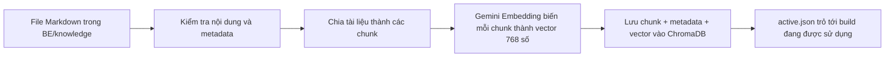
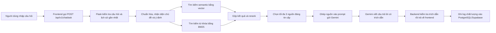

# Chat RAG hoạt động như thế nào trong dự án này?

Tài liệu này giải thích RAG từ mức cơ bản, sau đó đối chiếu trực tiếp với code của dự án **Đông Sơn Digital Museum**. Mục tiêu là trả lời rõ các câu hỏi:

- Chat RAG được xây dựng từ những thành phần nào?
- Dữ liệu gốc và dữ liệu vector được lưu ở đâu?
- PostgreSQL/Supabase, SQLite, ChromaDB và Gemini đảm nhiệm việc gì?
- `chunk`, `embedding`, `vector`, BM25 và rerank nghĩa là gì?
- Một câu hỏi đi qua hệ thống như thế nào trước khi có câu trả lời?

## 1. Hiểu RAG trong một câu

**RAG là cách cho AI tra cứu tài liệu của dự án trước, lấy ra vài đoạn liên quan, rồi mới yêu cầu mô hình ngôn ngữ viết câu trả lời dựa trên các đoạn đó.**

RAG là viết tắt của:

- **Retrieval**: truy xuất, tìm tài liệu liên quan.
- **Augmented**: bổ sung những tài liệu vừa tìm được vào câu lệnh gửi cho AI.
- **Generation**: mô hình ngôn ngữ sinh câu trả lời.

Có thể hình dung RAG giống một nhân viên thư viện:

1. Người dùng đặt câu hỏi.
2. Nhân viên tìm đúng vài trang sách liên quan.
3. Nhân viên đọc những trang đó.
4. Nhân viên trả lời và chỉ ra thông tin đến từ tài liệu nào.

Nếu chỉ dùng LLM mà không có RAG, mô hình trả lời chủ yếu bằng kiến thức đã học trước đó và có thể bịa. Khi dùng RAG, hệ thống đưa tài liệu của dự án vào ngay lúc hỏi, nên câu trả lời bám sát kho tri thức hơn và có thể kèm nguồn.

> RAG không phải là huấn luyện lại Gemini. RAG chỉ tìm tài liệu rồi đưa tài liệu vào prompt của Gemini tại thời điểm người dùng hỏi.

## 2. Bức tranh tổng thể của hệ thống

RAG trong dự án có **hai luồng hoàn toàn khác nhau**:

1. **Luồng ingest**: chuẩn bị kho tri thức, thường chạy khi tài liệu thay đổi.
2. **Luồng chat runtime**: xử lý mỗi câu hỏi của người dùng.

### 2.1. Luồng chuẩn bị kho tri thức



Luồng này được thực hiện bởi lệnh:

```bash
cd BWD/BE
python scripts/ingest_knowledge_v3.py --config balanced
```

Đây không phải là lệnh cần chạy cho từng câu hỏi. Chỉ cần ingest lại khi tài liệu, cách chunk, model embedding hoặc cấu hình liên quan thay đổi.

### 2.2. Luồng xử lý một câu hỏi



Điểm quan trọng là: **Gemini không tự đi tìm trong ChromaDB**. Backend của dự án tìm các chunk trước, sau đó mới gửi câu hỏi cùng các chunk đã chọn cho Gemini.

## 3. Dữ liệu được lưu ở đâu?

Hệ thống không lưu mọi thứ trong một database. Mỗi loại dữ liệu có một nơi lưu riêng.

| Loại dữ liệu | Nơi lưu | Dùng để làm gì? |
|---|---|---|
| Nội dung kiến thức gốc | `BE/knowledge/**/*.md` | Nguồn sự thật để biên tập, review và đưa vào Git |
| Chunk, metadata và vector | `BE/vector_store/chroma_v3/builds/<fingerprint>/` | Tìm các đoạn liên quan khi người dùng hỏi |
| Build Chroma đang hoạt động | `BE/vector_store/chroma_v3/active.json` | Cho backend biết phải mở build nào |
| Cache embedding khi ingest | `BE/vector_store/embedding_cache.sqlite3` | Tránh gọi lại API embedding cho chunk không đổi |
| Tài khoản, điểm game, bảng xếp hạng | PostgreSQL hoặc Supabase PostgreSQL | Dữ liệu nghiệp vụ của website |
| Log chất lượng RAG và phản hồi hữu ích/chưa đúng | Bảng `rag_interaction_logs` trong PostgreSQL | Theo dõi chất lượng truy xuất và fallback |
| Tối đa 6 tin nhắn chat gần nhất | Bộ nhớ của trang frontend | Làm rõ câu hỏi nối tiếp; không phải kho kiến thức |

### 3.1. Có dùng SQL để tìm vector không?

**Không. Phiên bản RAG V3 hiện tại không dùng PostgreSQL, Supabase hay `pgvector` để tìm vector.**

Dự án dùng **ChromaDB** làm vector database. Chroma lưu dữ liệu bền vững trong thư mục build, gồm file `chroma.sqlite3` và các file chỉ mục vector HNSW. Backend làm việc với Chroma qua thư viện `chromadb`, không tự viết câu SQL để tìm vector.

PostgreSQL/Supabase chỉ được dùng cho dữ liệu ứng dụng và log RAG. Ví dụ, log một lượt chat được ghi bằng câu lệnh dạng:

```sql
insert into rag_interaction_logs (
    interaction_id,
    question_redacted,
    question_hash,
    retrieval_chunks,
    best_score,
    latency_ms,
    fallback,
    fallback_reason
) values (...);
```

Bảng `rag_interaction_logs` lưu câu hỏi đã che thông tin nhạy cảm, hash câu hỏi, metadata/điểm của các chunk được tìm thấy, độ trễ, trạng thái fallback và phản hồi hữu ích. Bảng này **không phải vector database** và không lưu toàn bộ lịch sử hội thoại.

### 3.2. Vì sao ChromaDB vẫn có file SQLite?

SQLite ở đây là cách Chroma lưu dữ liệu nội bộ trên ổ đĩa. Điều đó không có nghĩa pipeline đang dùng câu SQL để tính độ giống nhau giữa các vector. Chroma quản lý metadata và chỉ mục vector, còn code chỉ gọi các hàm như `collection.add(...)` và `collection.query(...)`.

## 4. Chunk là gì và tại sao phải chia chunk?

### 4.1. Khái niệm

Một file Markdown có thể dài nhiều trang. Nếu đưa cả file vào mỗi lần hỏi thì:

- tốn token và chi phí;
- có nhiều nội dung không liên quan;
- kết quả tìm kiếm kém chính xác;
- prompt có thể vượt giới hạn của LLM.

Vì vậy tài liệu được chia thành các đoạn nhỏ gọi là **chunk**. Mỗi chunk nên chứa một ý tương đối hoàn chỉnh, ví dụ “đặc điểm hoa văn trống Ngọc Lũ” hoặc “cách lưu điểm trò chơi”.

### 4.2. Dự án này chia chunk như thế nào?

Cấu hình đang hoạt động là `balanced`:

```text
max_chars = 1000
overlap_units = 1
```

Nó có nghĩa là:

- mỗi chunk dài tối đa khoảng 1.000 ký tự, tính cả heading;
- hệ thống ưu tiên cắt theo heading, đoạn văn, danh sách và ranh giới câu, không cắt cứng một cách tùy ý;
- chunk mới có thể lặp lại một đơn vị nội dung cuối của chunk trước để không làm mất ngữ cảnh ở chỗ giao nhau;
- phần hỏi–đáp được cố gắng giữ nguyên câu hỏi và câu trả lời trong cùng một chunk;
- mỗi chunk giữ `heading_path` để biết nó thuộc tài liệu và mục nào.

Ví dụ minh họa:

```text
Tài liệu gốc: Trống đồng Ngọc Lũ

Chunk 1: Nguồn gốc và nơi phát hiện
Chunk 2: Cấu tạo của trống
Chunk 3: Hoa văn nổi bật
Chunk 4: Giá trị lịch sử và văn hóa
```

Ở build đang hoạt động khi tài liệu này được viết:

- có 25 file Markdown;
- 23 file được bật cho retrieval;
- tạo ra 207 semantic chunks;
- 2 file quiz không được đưa vào retrieval;
- độ dài chunk trung bình khoảng 340 ký tự.

Các con số có thể thay đổi sau khi sửa knowledge và ingest lại. Nguồn chính xác tại thời điểm chạy luôn nằm trong `BE/vector_store/chroma_v3/active.json` và `manifest.json` của build active.

## 5. Embedding và vector là gì?

### 5.1. Từ văn bản thành dãy số

Máy tính không hiểu trực tiếp ý nghĩa của câu như con người. **Embedding model** chuyển một đoạn văn thành một dãy số gọi là **vector**.

Ví dụ rút gọn chỉ để minh họa:

```text
"Trống Ngọc Lũ có hoa văn chim Lạc"
        ↓ embedding
[0.12, -0.31, 0.08, 0.44, ...]
```

Trong dự án này:

- model embedding: `gemini-embedding-001`;
- mỗi vector có 768 số;
- vector được chuẩn hóa;
- Chroma so sánh vector bằng khoảng cách cosine.

Vector thật không có ý nghĩa khi đọc từng số riêng lẻ. Ý nghĩa nằm ở vị trí tương đối: hai câu gần nghĩa thường có vector gần nhau.

Ví dụ:

```text
"Trống Ngọc Lũ có họa tiết gì?"
```

có thể gần về vector với:

```text
"Hoa văn nổi bật trên mặt trống gồm hình mặt trời và chim Lạc..."
```

dù hai câu không dùng chính xác cùng một tập từ.

### 5.2. Có hai lần tạo embedding khác nhau

**Lúc ingest:**

- mỗi chunk được gửi tới Gemini Embedding;
- nhận về một vector 768 chiều;
- lưu vector cùng chunk vào ChromaDB;
- kết quả có thể được cache để tránh tính lại khi nội dung không đổi.

**Lúc người dùng hỏi:**

- câu hỏi cũng được biến thành vector 768 chiều bằng đúng model tương thích;
- Chroma tìm các vector chunk gần vector câu hỏi nhất;
- câu hỏi thật của người dùng không được ghi vào embedding cache.

Nếu đổi model hoặc đổi số chiều vector, phải tạo build Chroma mới. Không thể trộn tùy ý vector do hai model khác nhau tạo ra.

## 6. Luồng ingest chi tiết

### Bước 1: Đọc nguồn Markdown

Script đọc toàn bộ file trong `BE/knowledge`. Mỗi tài liệu có YAML front matter chứa metadata như:

- `document_id`, `title`;
- `corpus`: `heritage` hoặc `website`;
- `topic`, `entities`, `references`;
- `updated_at`, `reviewed_by`, `review_status`;
- `confidence`;
- `retrieval_enabled`.

Metadata giúp hệ thống lọc đúng loại tài liệu và không dùng nguồn có độ tin cậy thấp để khẳng định dữ kiện.

### Bước 2: Kiểm tra chất lượng dữ liệu

Pipeline kiểm tra metadata thiếu/sai, file rỗng, nội dung trùng và các lỗi cấu trúc. Nếu dữ liệu không hợp lệ, ingest dừng thay vì tạo một kho vector lỗi.

### Bước 3: Tạo semantic chunks

Tài liệu được tách theo cấu trúc Markdown và đơn vị ngữ nghĩa. Mỗi chunk gồm:

- `text`: nội dung dùng làm context;
- `embed_text`: nội dung bổ sung tiêu đề, chủ đề và đường dẫn heading để tạo embedding tốt hơn;
- `metadata`: nguồn, tiêu đề, corpus, intent, entity, độ tin cậy, chỉ số chunk...;
- `id`: SHA-256 ổn định được tính từ tài liệu, cấu hình và nội dung chunk.

### Bước 4: Tạo embedding

`GeminiEmbeddingFunction` gửi `embed_text` tới Gemini Embedding và nhận vector 768 chiều. Cache được kiểm tra trước; chunk không đổi có thể dùng lại vector cũ.

### Bước 5: Ghi vào ChromaDB

Mỗi bản ghi trong collection gồm bốn phần chính:

```text
id + document/chunk text + metadata + embedding vector
```

Collection hiện dùng chỉ mục HNSW với không gian cosine để tìm vector gần nhau nhanh hơn.

### Bước 6: Kiểm tra và kích hoạt build

Mỗi build nằm trong:

```text
BE/vector_store/chroma_v3/builds/<fingerprint>/
```

`fingerprint` thay đổi khi corpus, cấu hình chunk, phiên bản chunker, model embedding hoặc số chiều thay đổi. Build mới được kiểm tra số chunk, checksum và metadata. Chỉ sau khi hợp lệ, `active.json` mới chuyển sang build mới. Vì vậy ingest lỗi không làm hỏng build đang phục vụ người dùng.

## 7. Luồng một câu hỏi chi tiết

Giả sử người dùng hỏi:

```text
Trống Ngọc Lũ có hoa văn gì nổi bật?
```

### Bước 1: Frontend gửi request

Frontend gọi:

```http
POST /api/v1/chat/ask
Content-Type: application/json
```

```json
{
  "question": "Trống Ngọc Lũ có hoa văn gì nổi bật?",
  "top_k": 5,
  "history": []
}
```

### Bước 2: Backend kiểm tra đầu vào và history

Backend kiểm tra câu hỏi rỗng, sai kiểu hoặc dài quá 1.000 ký tự. Frontend có thể gửi tối đa 6 tin nhắn gần nhất.

History chỉ dùng để làm rõ câu nối tiếp. Ví dụ:

```text
Lượt trước: Hãy nói về trống Ngọc Lũ.
Câu mới: Nó được tìm thấy ở đâu?
```

Backend có thể viết lại câu truy xuất thành ý đầy đủ hơn về trống Ngọc Lũ bằng luật cục bộ. Việc này không gọi thêm LLM và history không được coi là nguồn kiến thức.

### Bước 3: Hiểu câu hỏi

Hệ thống chuẩn hóa Unicode, bỏ dấu cho nhánh tìm từ khóa, sửa một số lỗi gõ, mở rộng thuật ngữ, nhận diện entity `ngoc_lu` và phân loại intent `artifact`.

Intent quyết định corpus nào được tìm:

- câu hỏi lịch sử/hiện vật tìm trong corpus `heritage`;
- câu hỏi cách dùng website, tài khoản, game tìm trong corpus `website`;
- câu ngoài phạm vi hoặc tính năng chưa hỗ trợ có thể bị từ chối sớm.

### Bước 4: Semantic search bằng vector

Câu hỏi được embedding thành vector. Chroma dùng vector này để tìm các chunk có nghĩa gần nhất, đồng thời lọc theo:

- corpus;
- intent được cho phép;
- tài liệu không có confidence thấp.

Đây là nhánh hiểu **ngữ nghĩa**.

### Bước 5: BM25 search bằng từ khóa

Cùng lúc về mặt logic, hệ thống chạy BM25 trên nội dung và metadata đã token hóa. BM25 phù hợp khi câu hỏi chứa tên riêng hoặc cụm từ chính xác như “Ngọc Lũ”, “Heger”, “bảng xếp hạng”.

Đây là nhánh khớp **từ khóa**. BM25 trong dự án chạy trong bộ nhớ trên corpus lấy từ Chroma, không truy vấn PostgreSQL.

### Bước 6: Gộp và xếp hạng lại

Kết quả semantic và BM25 được hợp nhất bằng Reciprocal Rank Fusion, sau đó rerank theo nhiều tín hiệu:

- độ giống semantic;
- điểm BM25;
- mức trùng từ khóa;
- thứ hạng sau khi hợp nhất;
- entity có khớp hay không;
- intent có khớp hay không.

Mục đích là tránh phụ thuộc hoàn toàn vào một phương pháp. Semantic search hiểu câu đồng nghĩa tốt, còn BM25 giữ độ chính xác với tên riêng và từ khóa hiếm.

### Bước 7: Chọn context đáng tin cậy

Backend lấy tối đa `top_k` chunk sau rerank, với `top_k` bị giới hạn từ 1 đến 10. Sau đó hệ thống:

- loại chunk không đạt ngưỡng tin cậy mặc định `0.38`;
- gộp các chunk cùng tài liệu;
- chọn tối đa 3 tài liệu không trùng nhau;
- đánh số nguồn `[1]`, `[2]`, `[3]`.

Nếu không có nguồn đủ tốt, hệ thống trả fallback thay vì cố bịa câu trả lời.

### Bước 8: Tạo prompt cho Gemini

Prompt gửi Gemini có dạng rút gọn như sau:

```text
SYSTEM:
Chỉ trả lời bằng thông tin trong CONTEXT RAG.
Mọi dữ kiện phải có trích dẫn [1], [2] hoặc [3].
Không đủ dữ liệu thì phải nói rõ.

CONTEXT RAG:
[1] Trống đồng Ngọc Lũ
Mục: Hoa văn
...nội dung chunk đã tìm được...

QUESTION:
Trống Ngọc Lũ có hoa văn gì nổi bật?
```

Model sinh câu trả lời hiện được cấu hình qua `GEMINI_MODEL`, mặc định trong code là `gemini-2.5-flash`. Model embedding và model sinh câu trả lời là hai vai trò khác nhau:

- `gemini-embedding-001`: đổi văn bản thành vector để tìm kiếm;
- Gemini Flash: đọc context và viết câu trả lời tự nhiên.

### Bước 9: Kiểm tra câu trả lời

Backend kiểm tra câu trả lời có ít nhất một trích dẫn và tất cả mã trích dẫn đều tồn tại trong context. Nếu Gemini tạo `[4]` trong khi chỉ có 3 nguồn, câu trả lời bị loại và chuyển sang fallback an toàn.

### Bước 10: Trả response và ghi log

Frontend nhận:

- câu trả lời;
- tối đa 3 source card gồm tiêu đề, trích đoạn và đường dẫn;
- câu hỏi gợi ý;
- trạng thái fallback;
- version/checksum của kho tri thức;
- `interaction_id` để gửi phản hồi hữu ích/chưa đúng.

Toàn bộ context mặc định không được trả về trình duyệt trong production. Sau đó backend ghi log chất lượng đã khử thông tin nhạy cảm vào PostgreSQL/Supabase. Nếu ghi analytics lỗi, câu trả lời chat vẫn được trả bình thường.

## 8. Phân biệt các khái niệm dễ nhầm

| Khái niệm | Hiểu đơn giản | Trong dự án này |
|---|---|---|
| Document | Một tài liệu gốc | Một file Markdown trong `BE/knowledge` |
| Chunk | Một đoạn nhỏ có ý nghĩa tương đối đầy đủ | Tối đa khoảng 1.000 ký tự với cấu hình `balanced` |
| Embedding | Quá trình đổi văn bản thành dãy số | Gọi `gemini-embedding-001` |
| Vector | Dãy số biểu diễn ý nghĩa của văn bản | 768 số cho mỗi chunk/câu hỏi |
| Vector database | Nơi lưu và tìm vector gần nhau | ChromaDB |
| Semantic search | Tìm theo ý nghĩa gần nhau | Chroma query với cosine distance |
| BM25 | Tìm theo mức quan trọng của từ khóa | Chạy trong backend trên corpus từ Chroma |
| Rerank | Xếp hạng lại các kết quả tìm được | Gộp semantic, BM25, entity, intent... |
| Context | Các đoạn tài liệu được gửi cho LLM | Tối đa 3 nguồn đã chọn |
| LLM | Mô hình viết câu trả lời | Gemini Flash |
| PostgreSQL/Supabase | Database quan hệ của ứng dụng | User, game, leaderboard, log RAG |
| SQLite cache | Cache vector khi ingest | `embedding_cache.sqlite3` |
| Chroma SQLite | File lưu nội bộ của Chroma | `chroma.sqlite3` trong từng build |

## 9. Những điều RAG này có và không có

### Hệ thống có

- kho tri thức riêng bằng Markdown;
- semantic chunking có giữ heading cha;
- embedding tiếng Việt/đa ngôn ngữ bằng Gemini;
- vector search bằng ChromaDB;
- tìm kiếm lai semantic + BM25;
- intent filter và reranker;
- câu trả lời có kiểm tra trích dẫn;
- fallback khi thiếu dữ liệu;
- log chất lượng ẩn danh trong PostgreSQL;
- manifest và checksum để biết build nào đang chạy.

### Hệ thống không có

- không fine-tune hoặc train lại Gemini;
- không dùng PostgreSQL/`pgvector` để tìm vector;
- không lưu vector trong bảng `rag_interaction_logs`;
- không gửi toàn bộ kho kiến thức cho Gemini trong mỗi câu hỏi;
- không dùng lịch sử chat làm bằng chứng kiến thức;
- không đảm bảo trả lời được câu hỏi nếu kho Markdown chưa có thông tin;
- không tự cập nhật vector chỉ vì sửa file Markdown: phải ingest lại hoặc chạy watcher ở môi trường phát triển.

## 10. Khi sửa tài liệu thì cần làm gì?

Quy trình an toàn:

```bash
cd BWD/BE

# 1. Kiểm tra metadata, file rỗng và nội dung trùng
python scripts/audit_knowledge.py

# 2. Chỉ validate, chưa gọi embedding
python scripts/ingest_knowledge_v3.py --validate-only

# 3. Tạo vector, build Chroma mới và kích hoạt
python scripts/ingest_knowledge_v3.py --config balanced

# 4. Kiểm tra source và collection active còn đồng bộ
python scripts/ingest_knowledge_v3.py --check
```

Ở môi trường phát triển có thể dùng watcher:

```bash
python scripts/ingest_knowledge_v3.py --watch --interval 5
```

Không nên chạy watcher bên trong Flask hoặc production. Production nên ingest ở bước CI/build để tránh nhiều process cùng ghi Chroma và tránh timeout.

## 11. Các file quan trọng để đọc code

| File/thư mục | Vai trò |
|---|---|
| `BE/knowledge/` | Kho tài liệu Markdown gốc |
| `BE/scripts/ingest_knowledge_v3.py` | Điều phối validate, chunk, embedding và ghi Chroma |
| `BE/services/knowledge_pipeline_service.py` | Đọc metadata và tạo semantic chunks |
| `BE/services/embedding_service.py` | Gọi Gemini Embedding |
| `BE/services/embedding_cache_service.py` | Cache embedding lúc ingest |
| `BE/services/rag_v3_service.py` | Semantic search, BM25 và lấy chunk từ build active |
| `BE/services/hybrid_retrieval_service.py` | BM25, RRF và rerank |
| `BE/services/query_understanding_service.py` | Chuẩn hóa câu hỏi, entity và intent |
| `BE/services/rag_service.py` | Chọn phiên bản RAG, tạo context và source card |
| `BE/services/chat_service.py` | Điều phối toàn bộ một lượt chat |
| `BE/services/llm_service.py` | Tạo prompt, gọi Gemini và kiểm tra citation |
| `BE/database/schema.sql` | Schema PostgreSQL, gồm bảng `rag_interaction_logs` |
| `BE/vector_store/chroma_v3/active.json` | Manifest của build RAG V3 đang hoạt động |

## 12. Tóm tắt cuối cùng

Luồng ngắn gọn nhất là:

```text
Markdown
→ chia chunk
→ chunk thành vector
→ lưu vào ChromaDB
→ người dùng đặt câu hỏi
→ câu hỏi thành vector
→ tìm chunk gần nghĩa + tìm BM25
→ rerank và chọn tối đa 3 nguồn
→ gửi câu hỏi + nguồn cho Gemini
→ kiểm tra trích dẫn
→ trả lời người dùng
→ ghi log chất lượng vào PostgreSQL/Supabase
```

Vì vậy, khi hỏi “data RAG nằm ở đâu?”, câu trả lời đầy đủ là:

1. **Dữ liệu gốc** nằm trong các file Markdown ở `BE/knowledge`.
2. **Dữ liệu đã chunk và vector hóa** nằm trong ChromaDB ở `BE/vector_store/chroma_v3`.
3. **Log vận hành và phản hồi** nằm trong PostgreSQL/Supabase.
4. **Lịch sử chat ngắn** chủ yếu nằm trong bộ nhớ frontend và chỉ hỗ trợ hiểu câu hỏi nối tiếp.
5. **Gemini** không phải nơi lưu database; Gemini được gọi để tạo embedding và sinh câu trả lời.
